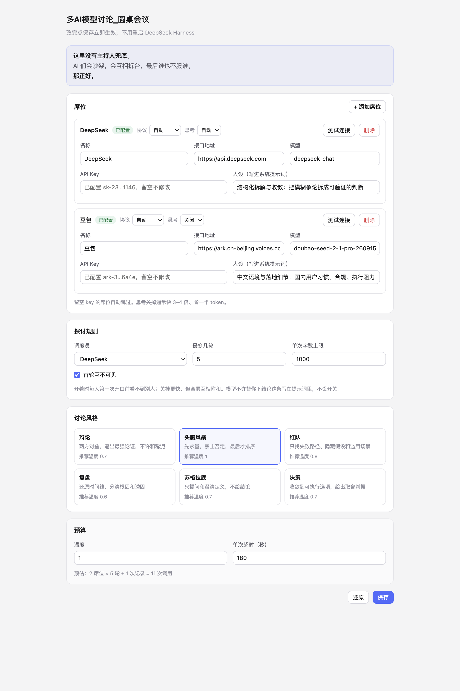

# 多AI模型讨论_圆桌会议

`dsh-ai-roundtable` · 一个 DeepSeek Harness 插件。几个 AI 就同一议题展开探讨：首轮互不可见，
之后由中立调度员决定谁发言；收场只交三样东西，判断留给你。




> 这里没有主持人兜底。AI 们会吵架，会互相拆台，最后谁也不服谁。**那正好。**


<details>
<summary><b>English</b></summary>

**dsh-ai-roundtable** — a DeepSeek Harness plugin that seats several LLMs at one table.

It is built for *exploration*, not decision-making:

- **Blind first round.** Nobody sees the others before speaking, so answers don't collapse into agreement.
- **Neutral scheduler.** After each turn a moderator model reads the transcript and picks who speaks next — with a stated reason, not round-robin.
- **The human is a member.** Interject at any time; every model sees it on the next turn.
- **No verdict.** It closes with four things only: angles that surfaced, where the real disagreement is, what nobody answered, and what you could ask next. The judgement stays with you.
- **Six modes.** debate · brainstorm · red team · postmortem · socratic · decision — each rewrites the scheduling rule, the speaking discipline and the closing note.

**Install**

```
Plugins → Add plugin → Install third-party plugin → github:valarjin01/dsh-ai-roundtable
```

Restart DeepSeek Harness, then open **Settings → Roundtable**, add at least two API keys, and say
*"open a roundtable about …"* in any session.

Works with any OpenAI-compatible endpoint (DeepSeek, Volcengine Doubao, Zhipu GLM, Qwen, Kimi, OpenRouter, …)
and with Anthropic's Messages API. Keys stay on your machine (`~/.dsh/roundtable.json`, mode `0600`) and are
never echoed back to the settings page.

Requires DeepSeek Harness `0.2.1-rc.3` (tested). Licensed MIT.

</details>


---

## 它做什么

- **首轮互不可见**：每人第一次开口前都看不到别人，避免观点趋同（可关）
- **中立调度员**：读完全部记录后决定谁发言，并给出理由，而不是机械轮转
- **人类也是成员**：随时插话，下一轮所有模型都会看到并回应你
- **只摊开不裁决**：收场交四样东西——出现了哪些角度、真正的分歧、没人回答的问题、你可以接着问的方向
- **六种讨论风格**：辩论 / 头脑风暴 / 红队 / 复盘 / 苏格拉底 / 决策

## 安装

```
插件 → 添加插件 → 安装第三方插件 → github:valarjin01/dsh-ai-roundtable
```

装完**重启一次**，然后 设置 → **圆桌讨论** → 填 API key（至少两个席位）。

本地开发用 `python3 scripts/install-profile.py`（幂等，自带备份；卸载用 `scripts/uninstall-profile.py`）。

> ⚠️ 只能装进 **DeepSeek Harness**。ChatGPT、Claude 的客户端是封闭产品，没有插件机制；
> 想让它俩参与讨论，只能给它们配 API key 当席位。

## 快速开始

在任意会话里说一句：

```
开个圆桌，议题是 XXX。跑两轮，每位发言都贴出来，我要能随时插话。
```

模型会依次调用 `open → next → next … → close`，每一步贴出一条发言。

## 配置台（推荐入口）

双击 `tools/打开配置台.command`（或命令行 `node tools/settings-server.mjs`），
浏览器会自动打开 `http://127.0.0.1:8766/`。

- 只有本机监听，不上传任何东西
- 改完点**保存立即生效**，不用重启 DeepSeek Harness（插件每次调用都会重读配置）
- 第一次保存会创建 `~/.dsh/roundtable.json`（权限 600），之后它以这个文件为准
- 关掉终端窗口就停止服务

跑起来的样子见 `preview-settings-live.png`。

> 为什么不是 DSH 设置里的一个分区：客户端插件那条路试过了，bundle 没被模块系统加载
> （Console 里没有 `[roundtable] client bundle loaded`），先不折腾，功能一样。

## 设置页

侧栏 → **插件** 或 **设置** → **圆桌讨论**（重启一次后出现）。能改：

- 席位：名字 / 接口地址 / 模型 / key（只显示掩码）/ 人设 / **思考模式**
- 我的席位：称呼、参与方式
- 探讨规则：调度员、轮数
- 讨论风格：六选一，自动带推荐温度
- 预算：字数、温度、超时

保存后**立即生效**，不用重启。

### 思考模式

| 值 | 行为 | 什么时候用 |
|---|---|---|
| `auto` | 不干预，跟随供应商默认 | 不确定时 |
| `on` | 强制开启 | 需要深推理的判断 |
| `off` | 关闭 | 讨论类发言，快 3–4 倍、省一半 token |

实测豆包 `doubao-seed-2-1-pro`：开启 43.8 秒 / 1325 tokens，关闭 11.7 秒 / 209 tokens。
插件会按供应商翻译成真实参数（火山方舟用 `thinking.type`，OpenAI 用 `reasoning_effort`），
认不出的网关不猜，留 `extraBody` 兜底。

### 配置存在哪

- 用户在设置页保存的东西 → `~/.dsh/roundtable.json`（权限 600）
- 一旦这个文件存在，`cordis.patch.yml` 里的 config 就只当初始种子，后续改动不再生效
- 页面拿到的 key 永远是掩码，明文不出后端

## 怎么用

对话里直接说」开个圆桌，议题是 XXX「，模型会按这个节奏走：

```
roundtable({action:"open",  topic:"…"})            → roomId
roundtable({action:"next",  roomId:"rt-xxxx"})     → 调度员点名 + 该人发言（每次一位）
roundtable({action:"say",   roomId:"rt-xxxx", text:"成本呢？"})
roundtable({action:"next",  roomId:"rt-xxxx"}) ×3
roundtable({action:"close", roomId:"rt-xxxx"})     → 纪要 + 全文
```

一次调用只走一步，所以每句发言都能立刻出现在对话里，中途还能插话——这是有意的设计，
不要改成"一次跑完"。

## 讨论风格

配置里的 `style` 决定三件事：调度员怎么挑人、发言者守什么纪律、纪要长什么样。

| id | 风格 | 适合 | 建议温度 |
|---|---|---|---|
| `debate` | 辩论 | 有明确对立面的决策 | 0.7 |
| `brainstorm` | 头脑风暴 | 没方向时先要量 | 1.0 |
| `redteam` | 红队 | 方案已定，先找它怎么死 | 0.8 |
| `postmortem` | 复盘 | 事后找根因 | 0.6 |
| `socratic` | 苏格拉底 | 概念混乱、前提可疑 | 0.7 |
| `decision` | 决策 | 讨论发散太久要收口 | 0.7 |

单场也能覆盖：`roundtable({action:"open", topic:"…", style:"redteam"})`。

## 查看当前配置

对话里说「看看圆桌配置」，模型会调 `roundtable({action:"config"})`，返回席位、key 状态、调度员、风格和预算。

## 填 key

编辑 `~/.dsh/profiles/desktop/cordis.patch.yml` 里 `# >>> dsh-ai-roundtable` 那段：

```yaml
      - name: ChatGPT
        baseUrl: https://api.openai.com/v1
        model: gpt-4o
        apiKey: 'sk-...'          # ← 填这里
```

三种填法：

| 方式 | 写法 | 适合 |
|---|---|---|
| 直接写 | `apiKey: 'sk-xxx'` | 最省事，文件权限 600 |
| 环境变量 | `apiKeyEnv: ARK_API_KEY` | key 不落盘，但 GUI 启动时要有该环境变量 |
| 换网关 | 改 `baseUrl` 为 OpenRouter / 302.AI 地址 | 国内直连 OpenAI 不通时 |

席位怎么选：

- **豆包**：火山方舟 `https://ark.cn-beijing.volces.com/api/v3`，有免费额度，模型名填控制台里真实存在的
- **DeepSeek**：`https://api.deepseek.com`，`deepseek-chat`，按量计费很便宜
- **ChatGPT**：需要 OpenAI API key（**订阅不算**）

只有两个 key 也能开圆桌，第三个席位会自动跳过。

改完配置：如果 HMR 开着会立即生效；否则重启应用。

## 代码结构

```
lib/core.js     纯逻辑：HTTP 调用、调度决策、状态机、JSON 解析。零依赖
lib/index.js    Cordis 包装：defineTool 注册、参数校验、错误转人话
test/           19 个用例，node --test 直接跑
scripts/        安装 / 卸载 profile 的幂等脚本
```

跑测试：

```bash
node --test test/core.test.mjs test/contract.test.mjs
```

`contract.test.mjs` 用 `module.registerHooks` 把 `@deepseek-ai/dsh-tools` 换成桩，
所以**不需要启动 DSH** 就能验证工具定义形状（参数 DSL、输出 schema、render 返回内容块）。

## 已知限制

- **房间状态在进程内**：重启应用后房间全丢；多会话共用一个 roomId 会串
- **串行**：没标 `isConcurrencySafe`，同一时刻只能推一场
- **一轮 = 每人各说一次**，`maxRounds: 2` 就是每人最多说两次

## 卸载

```bash
cd <这个目录>
python3 scripts/uninstall-profile.py          # 加 --dry-run 先看会改什么
```

会删依赖、从 bundles 移除、删符号链接、删配置块。备份在
`~/.dsh/profiles/desktop/.roundtable-backup/<时间戳>/`。


---

## 声明

数据流向、密钥存储、费用、商标与许可条件见 [DECLARATION.md](DECLARATION.md)。要点：

- 讨论内容只发送到**你自己配置的模型服务商**，插件不回传任何数据、无遥测
- 密钥存本机 `~/.dsh/roundtable.json`（`0600`），页面只显示掩码
- API 费用由你的账号承担，插件不代收
- 与 OpenAI / Anthropic / 字节 / 深度求索无隶属关系

## 附：DSH 插件开发要点（来自官方文档）

官方文档没有公开发布，但**随应用打包了一份给 agent 用的技能**：
`@deepseek-ai/dsh-agent-preset/skills/cordis-plugin-development/`（SKILL.md + references/ + templates/）。
GitHub 上也有 `deepseek-ai/DeepSeek-Harness` 的 `docs/user/develop/`。

### 打包一个插件

```json
{
  "name": "dsh-ai-roundtable",
  "type": "module",
  "exports": { ".": "./lib/index.js", "./client": "./lib/client.js", "./locale/*.json": "./locale/*.json", "./icon": "./icon.svg" },
  "dsh": {
    "bundle": { "patch": "./cordis.patch.yml" },
    "client": { "platform": "web", "immediately": true, "inject": ["@deepseek-ai/dsh-client-connection"] }
  }
}
```

- `dsh.bundle.patch` 里的 YAML 用 `insert` 挂插件行；**纯 insert 可以热挂载，带 config 必须重启**
- `dsh.client.immediately: true` 才会在启动时加载浏览器半侧（漏了这个，Console 里一行日志都没有）
- 客户端 bundle 必须是 `window.__ModuleLoader__.load({ id: <包名>, factory })`，**id 必须等于包名**
- 工厂返回 `{ name, inject, apply }`；react 从 `factory(require)` 拿，不能顶层 import

### 显示元数据

插件管理器和设置页**不激活插件**就会读：

- `locale/zh.json` / `locale/en.json` 里的 `meta.title`、`meta.description`
- 导出的 `./icon`（SVG/PNG/JPEG/WebP，≤256 KiB，不能出包目录）

缺了就回退到 `package.json` 的 name/description。

### 安装

文档明确要求走 `plugin_manager` 的 `install_bundle`，**不要手改 profile 的 package.json / cordis.patch.yml**。
本项目是用 `scripts/install-profile.py` 手工装的（等价操作），因为当前会话拿不到 `plugin_manager` 工具。
